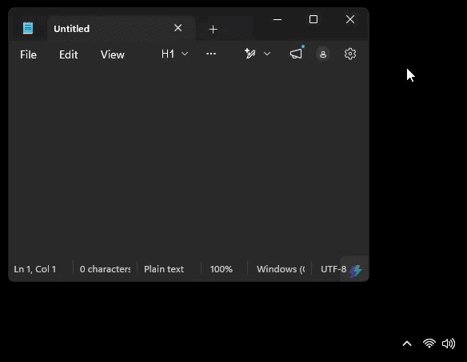

# minimize-to-tray

Windhawk tool for minimizing application windows to the system tray.

[Official Windhawk mod](https://github.com/ramensoftware/windhawk-mods/tree/main/mods/minimize-to-tray.wh.cpp)

## Demo

